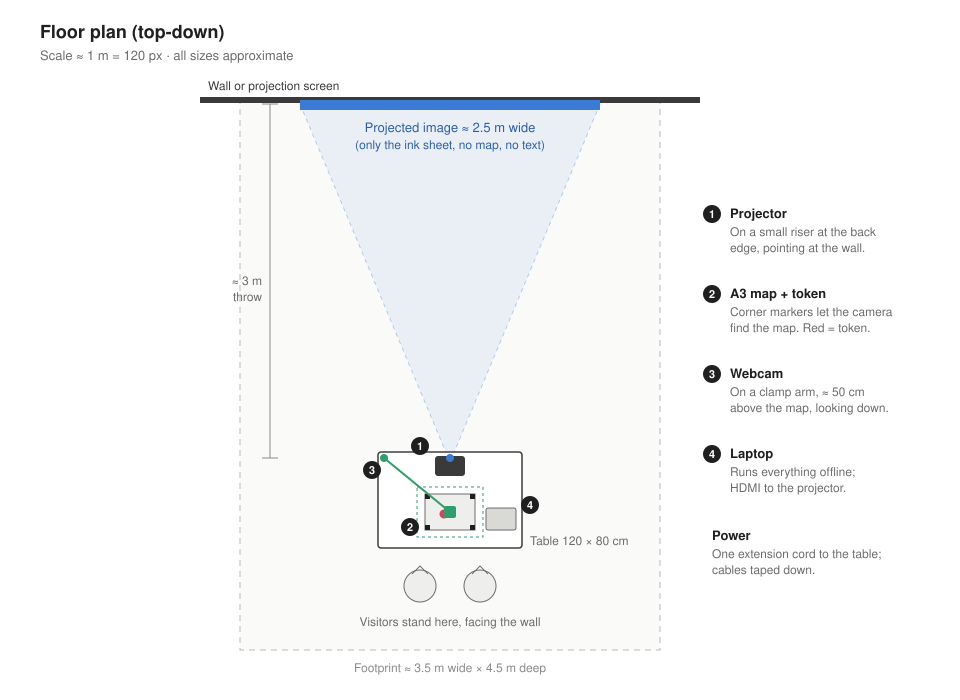
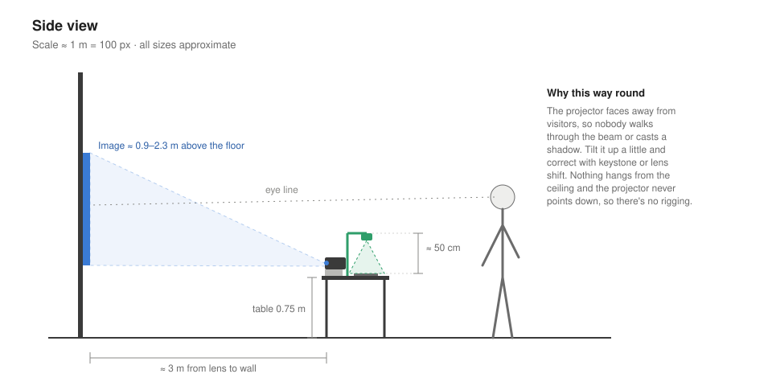
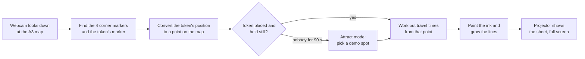

# Räckvidd: the installation

*How the piece will be set up and how it works, for NAVET Week at Scenkonstmuseet, 9–10 December 2026.*

**Status:** the software is built and running ([live prototype](https://rackvidd.vercel.app)). The physical setup described here (printed map, token, camera, projector) is planned and will be built after selection. This page explains how.

---

## The idea in one paragraph

*Räckvidd* means "reach" in Swedish. The piece shows how far you can get across Stockholm by public transport in an hour. A visitor puts a token on a printed map of the city. On a large projection, coloured ink spreads out from that spot to everywhere SL can take you, strong where you get within half an hour and fading out towards an hour. Each colour is a metro, train, tram, bus or ferry line, and the lines grow outwards as the ink spreads. Every spot paints a different picture: a well-connected place blooms wide; a poorly connected one stays a small blot.

## What a visitor does

1. Picks up the token and places it anywhere on the A3 map on the table: their home, their school, a place they've never been.
2. Looks up at the wall. The previous painting fades and a new one blooms from their spot over a few seconds.
3. Moves the token to compare: Slussen against Skarpnäck, Kista against Lidingö.
4. When nobody is playing, the projection paints on its own from a rotating set of places, so the piece is never blank.

No screen to touch, no text to read, no sound. The map on the table is the only place with names on it; the projection is pure ink.

## Layout

**Space needed:** about 3.5 × 4.5 m in front of a light-coloured wall or projection screen, ideally where the light is a little dimmer.

**Why this arrangement:** the projector sits on the table pointing away from visitors, so nobody walks through the beam or casts a shadow, and nothing has to be rigged overhead. The visitor looks down to place the token and up to watch the result, which keeps the map and the painting separate, the same split as the [prototype](https://rackvidd.vercel.app): map on the left, sheet on the right.

## How it works

Everything runs in one web page in a browser on the laptop, with no server and no internet needed. The laptop screen shows a control view (camera feed with detected markers); the projector shows only the ink sheet.

### 1. Travel times (built)

- **Data:** a full weekday SL timetable (metro, trams, light rail, inner-city buses), plus commuter rail and ferries with estimated timetables. Sources and limitations are listed in the [README](../README.md#data-and-limitations).
- **Routing:** a Connection Scan router in the browser finds the fastest door-to-door journeys from the chosen point, including walking to the stop (1.25 m/s, with a 30% allowance for streets not being straight) and waiting for departures. Each result is the average of eight departures between 08:00 and 08:20, so the picture doesn't depend on just missing one train.
- **Grid:** the region (about 38 × 41 km, covering every station in the data) is split into 200 m cells, and each cell gets a travel time and the line that reaches it.

### 2. Painting (built)

- Each cell becomes ink in the colour of its line: full strength up to 30 minutes, fading out by 60. The ink is blurred, granulated and pools at its edges like watercolour, on a generated cold-press paper texture.
- The lines you'd ride are drawn station to station and grow in step with the ink, so you can watch the network branch out.
- A new placement fades the old painting (0.3 s) before the new one blooms (about 3 s).

### 3. Reading the token (to build)

- **Markers:** the printed map has four square fiducial markers (ArUco) at its corners, and the token carries a fifth one on top. Markers are designed to be found quickly and reliably by a camera, even when tilted or partly in shadow.
- **Detection:** the browser reads the webcam and finds the markers with a JavaScript ArUco library (for example js-aruco2) at camera frame rate.
- **From camera to map:** the four corner markers give a perspective transform (a homography) from camera pixels to positions on the paper. The print is drawn from exactly the same map projection as the software, so a position on the paper converts directly to a point on the map. Because the camera doesn't move, the transform is measured once at setup and only refreshed when all four corners are visible, so a hand covering a corner doesn't matter.
- **When to paint:** a new painting starts when the token has been still for about 0.6 s and has moved more than about 300 m on the map since the last one. This ignores the token while it's being carried, and stops tiny wobbles from restarting the painting.
- **Nobody there:** if no token is seen for 90 s, attract mode paints from a rotating list of places every 15 s or so, until a token appears again.

### 4. Kiosk mode (to build)

- The page opens full screen with the sheet only: no map, no buttons, no key, no cursor.
- A keyboard shortcut on the laptop recalibrates the camera, and another switches to mouse control.

### 5. Print and token (to build)

- **Map print:** exported from the software at A3 (or A2 if the budget allows) with the four corner markers, a title and one line of instruction: *Place the token anywhere.* Mounted on foam board so it lies flat.
- **Token:** a disc about 4 cm across with the marker on top and a coloured rim, so it reads as an object to pick up rather than a sticker.

## Setup on the day

About **1 hour** to set up and **30 minutes** to pack down.

1. Place the table about 3 m from the wall and tape down the power cable.
2. Put the projector on its riser at the back edge, aim it at the wall, and square the image with keystone or lens shift.
3. Tape the map board to the table in front of it and clamp the webcam arm over it.
4. Start the laptop in kiosk mode and run the camera calibration (one key press).
5. Test placements across the whole map, including the corners and the edges.
6. Check the projection in the room's actual lighting and adjust brightness.
7. Leave attract mode running.

## What could go wrong

| Risk | What happens instead |
| --- | --- |
| Camera loses the token (bad light, glare) | Clamp lamp for even light, matte print to avoid glare; mouse control as a fallback so the piece keeps running |
| A visitor's hand covers a corner marker | The saved transform keeps working; corners are only re-measured when all four are visible |
| Projector bumped or moved | Painting is projector-independent; re-square the image, no recalibration needed |
| Laptop or browser crash | Reload the page: kiosk mode and calibration are back in under a minute |
| No projector available from the venue | Rented with the 1,500 SEK, or shown on a large TV instead |
